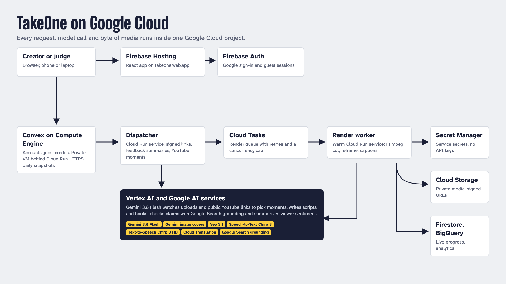

# TakeOne

TakeOne turns one long video into captioned vertical shorts for audiences in their own language. Upload a video you own, write a prompt, or paste a public YouTube link. Gemini watches the video, frames and audio, picks the strongest moments with a hook and a reason, and a Cloud Run worker renders 9:16 shorts with word-timed captions in 12 languages. Every clip gets a claims check grounded in Google Search, and viewer notes turn into sentiment a creator can act on.

Try it at **https://takeone.web.app**: choose "Continue as guest" and you get five free videos with no account.

Built by team Hacker bros for the Google Cloud AI Builder Cup 2026, theme "Media, Content & Digital Experiences".

## How it uses Google Cloud

Everything runs in one Google Cloud project. Services call Google APIs as their own service accounts; the app holds no API keys.

| Need | Google Cloud |
|---|---|
| Watch a video and pick moments, write scripts and hooks, check claims, summarize feedback | Gemini 3.8 Flash on Vertex AI, with Google Search grounding for claims |
| Find moments in a public YouTube video without downloading it | Gemini on Vertex AI reading the YouTube URL |
| Word-timed captions | Speech-to-Text v2, Chirp 3 |
| Captions in 12 languages | Cloud Translation v3 |
| Narration | Text-to-Speech, Chirp 3 HD voices |
| AI video from a prompt | Veo 3.1 Fast, capped per day |
| Cover image per short | Gemini image model |
| Web app and sign-in | Firebase Hosting, Firebase Auth (Google and guest) |
| Live render progress in Studio | Firestore |
| Rendering | Cloud Run: a warm worker service fed by Cloud Tasks, plus the dispatcher |
| Accounts, jobs and credits | Convex, self-hosted on a private Compute Engine VM behind Cloud Run HTTPS proxies |
| Media | Cloud Storage, private, short-lived signed URLs |
| Analytics | BigQuery `takeone_analytics` (renders and feedback) |
| Secrets, images, infrastructure | Secret Manager, Cloud Build, Artifact Registry, Terraform |



## Features

- Best moment of an upload: Gemini watches the uploaded file itself, so videos without captions work, and returns a captioned 9:16 short.
- Prompt to AI video with Veo 3.1, or narration over stock footage when a stock provider key is set.
- YouTube moments: paste a public link and Gemini returns up to three moments. Each plays in the official YouTube player, unmodified, with captions synced below it, translation, a share page at `/clip/:id` and a hand-off to render an MP4 from your own copy. TakeOne never downloads YouTube video.
- Captions from Speech-to-Text Chirp 3 in clean, bold pop or pop-in styles, in English, Hindi, Tamil, Telugu, Bengali, Marathi, Japanese, Korean, Simplified Chinese, Thai, Indonesian or Vietnamese, with Noto fonts for each script.
- Claims check: Gemini lists up to five checkable claims in a clip and checks each with Google Search grounding, showing a verdict, a reason and the cited sources. TakeOne opts out of storing Search Suggestions, as Google's terms allow for Gemini 3.
- Review links with timed guest notes, and a Gemini summary of overall sentiment, themes and a marker per note.
- Studio: trim, speed, reframe, follow one speaker, three opening hooks, brand kits, soundtracks, caption restyling and wording fixes, a multi-shot timeline, and version history.
- Live progress: the worker writes each render stage to Firestore and Studio shows it as it happens.
- Cost guards: five free videos per account, `FREE_DAILY_RENDER_CAP` (150), `AI_VIDEO_DAILY_CAP` (10) and `YOUTUBE_DAILY_CAP` (100) per UTC day, checked before any work starts.

The app reads a server-owned capability snapshot and hides any action whose provider is not configured, so an unconfigured provider never shows up as a working button.

## Configuration

- Gemini: `GEMINI_PROJECT`, `GEMINI_LOCATION` (default `global`), `GEMINI_MODEL` (for example `gemini-3.8-flash`).
- Captions: `SPEECH_LOCATION` (`us` or `eu`), `SPEECH_MODEL` (`chirp_3`). Narration: `TTS_VOICE` (a Chirp 3 HD voice such as `en-US-Chirp3-HD-Charon`), `TTS_LANGUAGE`.
- Covers: `IMAGE_MODEL`, `IMAGE_LOCATION`. Veo: the `veo` Terraform input plus `AI_VIDEO_ENABLED` in Convex.
- Firestore progress: `FIRESTORE_PROJECT`. Analytics: `BIGQUERY_PROJECT`, `BIGQUERY_DATASET`.
- Rendering path: Terraform `render_dispatch` is `tasks` (warm worker) or `jobs` (one Cloud Run Job per render), with `worker_min_instances` and `worker_max_instances`.
- Convex: `FIREBASE_PROJECT_ID`, `WORKER_SECRET`, `DISPATCH_SECRET`, `DISPATCH_URL`, `APP_URL`, and the daily caps above.

Convex admits at most ten running jobs at once and one per account. A worker holds a 90-second lease and Convex retries a lost job up to three times before it refunds the allowance. Sources are capped at 50 MiB and 300 seconds.

## Local development

Requirements: Node.js 22, FFmpeg, yt-dlp and espeak-ng.

```bash
npm ci
npm run dev

cd backend
npm ci
npm test
```

Copy `.env.example` to `.env.local` for the web app and `backend/.env.example` to `backend/.env` for the worker. Production rendering fails closed when required providers are missing. Offline fixtures are used only by explicit tests and local development paths.

## Validation

```bash
npm run build
npm run typecheck:convex
npm run lint
npm test

cd backend
npm run typecheck
npm run build
npm test

terraform -chdir=infra init -backend=false
terraform -chdir=infra fmt -check
terraform -chdir=infra validate
terraform -chdir=infra test
```

CI runs all of the above, then builds the production container and runs a real FFmpeg render and decode inside it with networking disabled.

## Deployment

The live deployment runs from the committed tree:

1. Build the worker image with Cloud Build from `backend/` and pin its digest in your `infra/*.tfvars`.
2. `terraform apply` in `infra/` creates the dispatcher, the warm worker, the Cloud Tasks queue, the render job, the bucket, the BigQuery dataset and every IAM binding. See [GCP infrastructure](infra/README.md).
3. The Convex backend runs self-hosted on Compute Engine: `infra/convex-vm/startup.sh` boots it on a private VM, and `infra/convex-proxy/` is the Cloud Run HTTPS front. Deploy functions with `npx convex deploy` against `CONVEX_SELF_HOSTED_URL`.
4. Build the web app and publish it with `node scripts/firebase-deploy.mjs`, which uploads `dist/` to Firebase Hosting and releases `firestore.rules` using only an OAuth access token.

Readiness notes: [connections to complete](docs/readiness/OWNER-CONNECTIONS.md), [release acceptance](docs/readiness/RELEASE-ACCEPTANCE.md), [analytics queries](docs/readiness/analytics.md).

## Legal routes

The web app publishes `/privacy`, `/terms`, `/acceptable-use`, `/copyright` and `/refund-policy`. Keep product behavior, retention settings and provider configuration in line with those pages.

## License

MIT. See [backend/LICENSE](backend/LICENSE).
